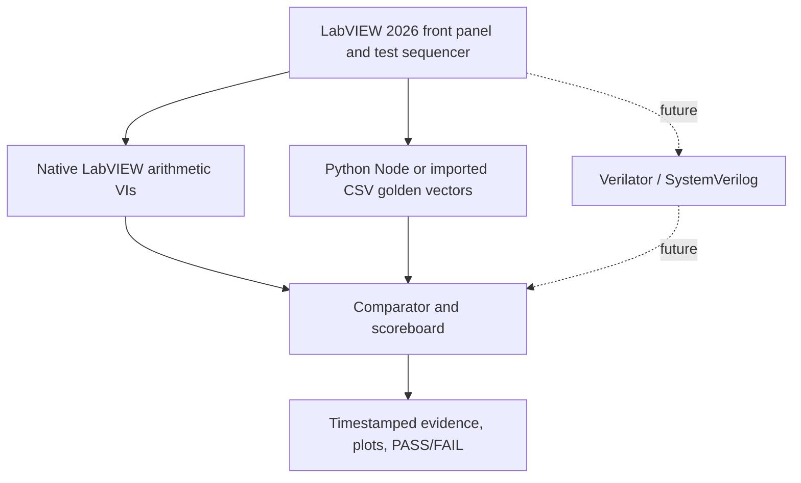
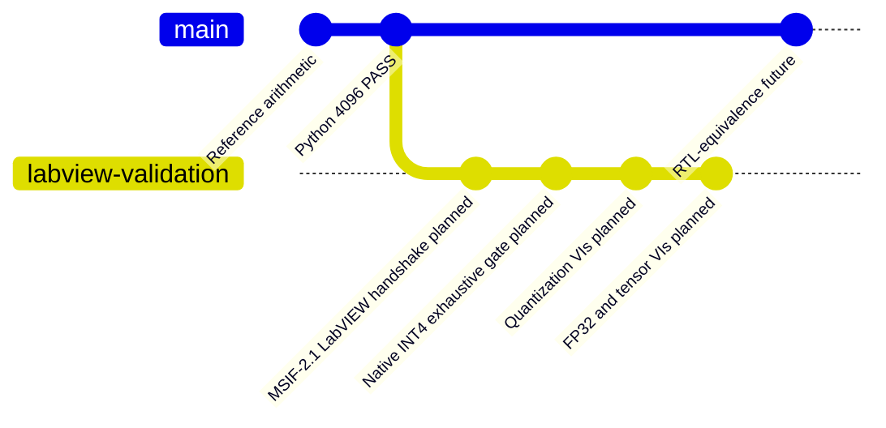
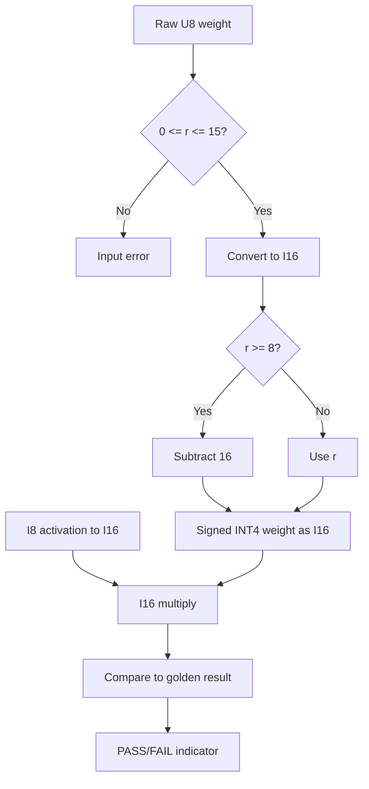
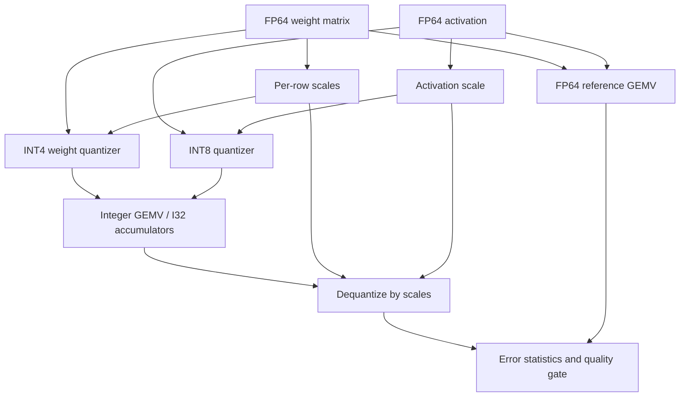
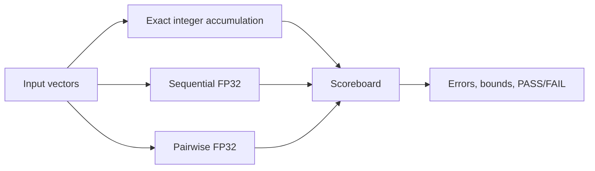
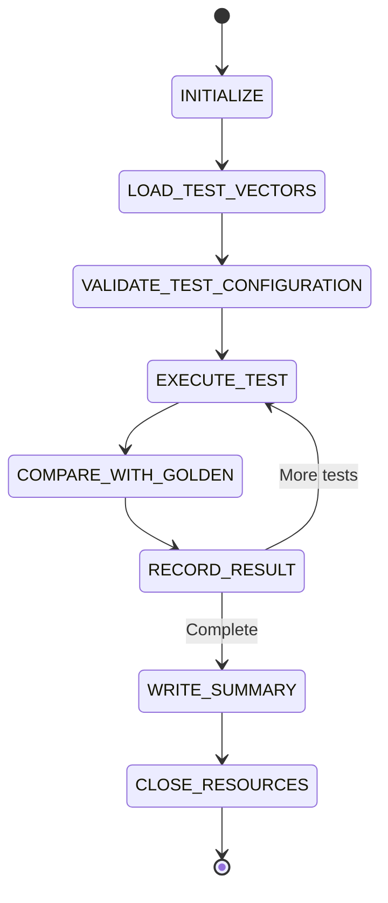
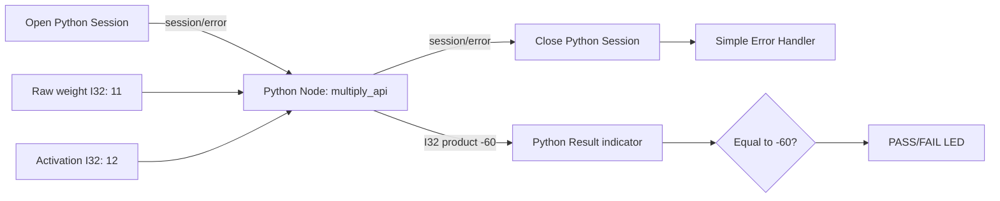

# LabVIEW-Based Verification of Four-Bit AI Inference Arithmetic on Node1

> **MSIF Arithmetic Verification | Node1 Ubuntu 24.04 LTS | LabVIEW 2026 64-bit | Python 3.12.3**  
> Document-first, GitHub-reviewable technical specification. No LabVIEW verification is claimed as completed.  
> Source: the earlier conversation section beginning **“LabVIEW-Based Verification of Four-Bit AI Inference Arithmetic on Node1”** and ending at its **“Final outcome”** paragraph. This edition converts Word equation images to GitHub-native LaTeX, diagrams to Mermaid and corrects known arithmetic wording without changing the design intent.

**Scope:** mathematical Sections 2.1–2.5, LabVIEW architecture, simulation and verification, Python reference, golden fixtures, later RTL, acceptance and evidence.

**Status from supplied Node1 logs:** `python3 msif_reference.py test --out vectors` has passed all 4,096 multiplier combinations, accumulator checks, GEMM and softmax. **Native LabVIEW VIs have not yet been verified.**

## Reference system architecture



## Milestone history (Mermaid `gitGraph`)

The `gitGraph` type depicts milestone progression/revision history. Architecture, dataflow and control-state diagrams use Mermaid `flowchart` and `stateDiagram-v2`, because a Git history graph cannot truthfully express signal/data paths.



# Document control, assumptions and scope

| Item             | Definition                                                                                              |
|------------------|---------------------------------------------------------------------------------------------------------|
| Target           | Node1 Ubuntu 24.04 LTS workstation; LabVIEW 2026 Community installation to be confirmed; Python 3.12    |
| Scope            | Sections 2.1–2.5: signed INT4, accumulator width, quantization, floating-point accuracy, linear algebra |
| Out of scope     | Physical RTL timing, FPGA timing, ASIC PPA and silicon signoff until subsequent stages                  |
| Ground truth     | Python standard-library golden model; independent native LabVIEW arithmetic                             |
| Deliverables     | LabVIEW project/VI hierarchy, test vectors, scoreboards, audit logs, acceptance report                  |
| Revision control | Fixture versions and SHA-256; source commit and environment recorded for each run                       |

# Executive objective

Create a reproducible Model-Silicon Arithmetic Verification Workbench on Node1. Each native LabVIEW VI shall execute a precisely defined numerical operation independently of Python. A reference implementation will generate expected results and fixtures. The application shall compare numerical results, report individual failures, and preserve machine-readable evidence.

# Contents

1\. Verification architecture and tool qualification

2\. Experiment 2.1 — signed four-bit arithmetic

3\. Experiment 2.2 — accumulator width and overflow

4\. Golden-reference package and Python integration

5\. Experiment 2.3 — quantization

6\. Experiment 2.4 — accumulation error and FP32

7\. Experiment 2.5 — linear algebra and attention

8\. LabVIEW project structure, controller and logging

9\. Future RTL equivalence

10\. End-to-end acceptance and execution sequence

11\. References, caveats and final outcome

# 1. Verification architecture and tool qualification

The verification hierarchy is (A) mathematical simulation, (B) fixed-width architecture emulation, and (C) eventual RTL or physical hardware verification. Native LabVIEW and Python constitute independent implementations only when LabVIEW performs its own computation. Merely displaying Python outputs does not establish LabVIEW correctness.


Figure 2 — Main architecture and verification handoff

| Mode | Integration                                            | Use                                    |
|------|--------------------------------------------------------|----------------------------------------|
| A    | Open Python Session → Python Node → Close Session      | Live reference arithmetic              |
| B    | Read CSV/JSON golden vectors and compute in native VIs | Preferred stable regression/fallback   |
| C    | Import Verilator/SystemVerilog results                 | Later cycle and arithmetic equivalence |

## 1.1 Compatibility check

NI documentation describes Python Node integration and the supported Python-version matrix. LabVIEW 2026 supports Python 3.9–3.12, with newer Q3 support for 3.13/3.14. Linux application compatibility and actual installed bitness must be confirmed locally. Python Node is not supported on LabVIEW FPGA and real-time targets; the current target is desktop LabVIEW.

<table>
<colgroup>
<col style="width: 100%" />
</colgroup>
<thead>
<tr class="header">
<th>uname -a<br />
lsb_release -a<br />
python3 --version<br />
command -v python3<br />
command -v labview || true<br />
python3 -c "import sys; print(sys.executable); print(sys.maxsize &gt; 2**32)"</th>
</tr>
</thead>
<tbody>
</tbody>
</table>

1.  Record the exact LabVIEW build using Help → About LabVIEW.

2.  Confirm Python interpreter architecture and path; use supported 64-bit Python on a compatible 64-bit desktop LabVIEW installation.

3.  Run a Python Node hello-world test only after checking compatibility.

4.  If Python Node fails, continue with offline golden CSV fixtures and native VIs; preserve the error text.

5.  Record Node1 OS, CPU, installed NI software, and Python environment in environment.json.

# 2. Experiment 2.1 — signed four-bit representation

A raw four-bit field r in 0..15 denotes a signed two’s-complement weight w in −8..7. The sign bit has negative positional value.

$$w=-8b_3+4b_2+2b_1+b_0,\quad b_i\in\{0,1\}$$

$$w=\begin{cases}r,&0\le r<8\\r-16,&8\le r\le15\end{cases}\qquad p=wx$$

Example: binary 1011 = −8+0+2+1 = −5. Multiplying by activation 12 yields −60. Use U8 for the encoded field, I16 for the decoded weight and activation-extension, and I16 for the exact product.

## 2.1 Front-panel contract

| Control / indicator | LabVIEW representation       | Initial value |
|---------------------|------------------------------|---------------|
| Raw Weight          | U8 numeric; only 0..15 valid | 11            |
| Activation          | I8 numeric; −128..127        | 12            |
| Signed Weight       | I16 indicator                | −5            |
| Product             | I16 indicator                | −60           |
| Binary Weight       | String indicator             | 1011          |
| Expected Product    | I16 indicator                | −60           |
| PASS                | Boolean LED                  | True          |

## 2.2 VI construction



Figure 3 — INT4_Decode_Multiply.vi dataflow

6.  Create INT4_Decode_Multiply.vi with the seven controls/indicators above.

7.  Wire raw-weight validation before the Case Structure.

8.  Convert raw U8 to I16; when raw ≥ 8 subtract 16, otherwise pass through.

9.  Convert activation to I16; multiply I16 values.

10. Compare product with expected I16 result and emit PASS/FAIL.

11. Reject all invalid raw encodings; do not silently mask input bits.

## 2.3 Exhaustive verification

There are 16 possible weights and 256 possible activations. Test all 4,096 pairs. The true extrema are maximum +1,024 (−8 × −128) and minimum −1,016 (−8 × 127); signed 12-bit represents both.

| Raw bits | Signed weight | Activation | Expected |
|----------|---------------|------------|----------|
| 0000     | 0             | 127        | 0        |
| 0001     | 1             | −128       | −128     |
| 0111     | 7             | 127        | 889      |
| 1000     | −8            | −128       | 1024     |
| 1011     | −5            | 12         | −60      |
| 1111     | −1            | 127        | −127     |

PASS criterion: all 4,096 rows attempted, all valid rows equal the golden result, zero invalid/skipped rows, and out-of-range encodings rejected.

# 3. Experiment 2.2 — exact accumulator width

$$w\in[-8,7],\quad x\in[-128,127],\quad -1016\le wx\le1024$$

$$-1016K\le\sum_{j=1}^{K}w_jx_j\le1024K$$

$$B_{\mathrm{acc}}=1+\left\lceil\log_2(1024K+1)\right\rceil,\quad K\ge1$$

This formula gives the required signed width for positive integer K when the bias is excluded. Bias may require more bits. Critical correction: K=4,096 needs 24 signed bits, not 23.

| K     | Maximum sum | Signed width |
|-------|-------------|--------------|
| 1     | 1,024       | 12           |
| 16    | 16,384      | 16           |
| 64    | 65,536      | 18           |
| 256   | 262,144     | 20           |
| 1,024 | 1,048,576   | 22           |
| 4,096 | 4,194,304   | 24           |

## 3.1 Accumulator_Width.vi

| Item                | Type / behavior                   |
|---------------------|-----------------------------------|
| Vector length K     | U32 control                       |
| Accumulator width B | U8 control                        |
| Weight pattern      | Enum: maximum/minimum/random/zero |
| Exact sum           | I64 indicator                     |
| Wrapped sum         | I64 indicator                     |
| Required width      | U8 indicator                      |
| Overflow            | Boolean LED                       |
| Result status       | String indicator                  |

$$u=s\bmod 2^B,\qquad \mathrm{wrap}_B(s)=\begin{cases}u,&u<2^{B-1}\\u-2^B,&u\ge2^{B-1}\end{cases}$$

12. Generate deterministic arrays of K weights and activations.

13. In a For Loop, multiply each I64-cast pair and accumulate through an I64 shift register.

14. Calculate B from the exact range, using a mathematical formula or bounded lookup.

15. Evaluate wrap_B(s) explicitly for the user-selected B; avoid relying on LabVIEW implicit integer overflow.

16. Compare exact and wrapped sums, show the overflow flag, log all data.

17. Repeat with positive and negative extremes and zero/random arrays.

| ID      | K    | Weight | Activation | Expected  |
|---------|------|--------|------------|-----------|
| ACC-001 | 1    | −8     | −128       | 1,024     |
| ACC-002 | 16   | −8     | −128       | 16,384    |
| ACC-003 | 64   | −8     | −128       | 65,536    |
| ACC-004 | 64   | −8     | 127        | −65,024   |
| ACC-005 | 4096 | −8     | −128       | 4,194,304 |

Boundary demonstration: a signed 17-bit accumulator tops out at +65,535, so ACC-003 overflows; signed 18-bit accumulation represents +65,536 exactly.

# 4. Reference package and Python integration

Previously generated package: msif_labview_node1_reference.zip with standard-library msif_reference.py and fixtures. Package location may vary once copied to Node1. This document does not claim it contains binary LabVIEW VIs.

<table>
<colgroup>
<col style="width: 100%" />
</colgroup>
<thead>
<tr class="header">
<th>mkdir -p ~/dev/pub/ai-sys1/model-silicon-research<br />
cd ~/dev/pub/ai-sys1/model-silicon-research<br />
# Copy the ZIP here before extraction<br />
unzip msif_labview_node1_reference.zip<br />
cd msif_labview_node1<br />
python3 --version<br />
python3 msif_reference.py generate --out vectors<br />
python3 msif_reference.py test --out vectors<br />
sha256sum vectors/* &gt; vectors/sha256sums.txt</th>
</tr>
</thead>
<tbody>
</tbody>
</table>

| Fixture                   | Purpose                                     |
|---------------------------|---------------------------------------------|
| int4_all_4096.csv         | All 4,096 INT4 × INT8 products              |
| dot64_1004.csv            | 1,004 deterministic 64-element dot products |
| quant_case.json           | FP and quantized inference fixture          |
| float_case.json           | Floating-point accumulation fixture         |
| linear_algebra_cases.json | Linear-algebra reference cases              |
| manifest.json             | Formats and random seeds                    |

## 4.1 Python_Handshake.vi

18. Place Open Python Session, Python Node, Close Python Session and Simple Error Handler on the LabVIEW block diagram.

19. Configure module path as the absolute msif_reference.py file and function as multiply_api.

20. Wire two integer inputs and one signed integer output, with session reference and error cluster across nodes.

21. Test raw 11, activation 12, expected −60.

22. Independently run the native INT4_Decode_Multiply.vi and compare it to −60.

23. On incompatibility use System Exec.vi or offline golden CSV; log diagnostic and keep native VI validation separate.

The Python Node must never be the only implementation under test. A Python self-test is not evidence that the LabVIEW VI passed.

# 5. Experiment 2.3 — quantization mathematics

Use FP64 reference math, symmetric per-output-channel INT4 weights and symmetric INT8 activations. Research default: quantized weights clipped to \[−7,7\] to preserve symmetric range, although the INT4 hardware supports \[−8,7\]. Round-to-nearest, ties-to-even.

$$y_{\mathrm{ref}}=Wx$$

$$s_{w,i}=\frac{\max_j|W_{ij}|}{7},\quad s_x=\frac{\max_j|x_j|}{127}$$

$$q_{w,ij}=\operatorname{clip}_{[-7,7]}\left(\operatorname{roundEven}\left(\frac{W_{ij}}{s_{w,i}}\right)\right)$$

$$q_{x,j}=\operatorname{clip}_{[-128,127]}\left(\operatorname{roundEven}\left(\frac{x_j}{s_x}\right)\right)$$

$$a_i=\sum_jq_{w,ij}q_{x,j},\quad \widehat y_i=s_xs_{w,i}a_i$$

When a row or input vector is zero, choose a documented positive scale floor (the reference uses 10⁻¹²). This is a project choice, not a universal quantization rule.

## 5.1 SubVI inventory and wiring

| SubVI                        | Function                                          |
|------------------------------|---------------------------------------------------|
| Compute_Weight_Scales.vi     | Row-wise maximum absolute magnitude → INT4 scales |
| Compute_Activation_Scale.vi  | Vector maximum absolute magnitude → INT8 scale    |
| Quantize_Weights_INT4.vi     | Divide, ties-even round, signed clip              |
| Quantize_Activations_INT8.vi | Divide, ties-even round, signed clip              |
| Integer_GEMV.vi              | I32 exact accumulation of integer products        |
| Dequantize_Output.vi         | Apply row scale and activation scale              |
| Compare_Quantization.vi      | MAE, RMSE, maximum error, cosine similarity       |



Figure 4 — Quantization simulation dataflow

$$\mathrm{MAE}=\frac{1}{M}\sum_i|y_i-\widehat y_i|$$

$$\mathrm{RMSE}=\sqrt{\frac{1}{M}\sum_i(y_i-\widehat y_i)^2}$$

$$E_{\max}=\max_i|y_i-\widehat y_i|$$

$$\cos\theta=\frac{y^T\widehat y}{\|y\|_2\|\widehat y\|_2}$$

Quantizer correctness requires exact equality of integer outputs with the golden fixture. Approximation quality uses a pre-agreed numeric error tolerance relative to FP64. Treat zero norms and near-zero denominators explicitly.

# 6. Experiment 2.4 — accumulation and floating-point error

Implement three paths: exact sufficiently wide integer accumulation; sequential IEEE binary32 multiplication-and-summation; balanced pairwise binary32 summation. Add a Python math.fsum or higher-precision comparison where appropriate.

$$S_I=\sum_j q_{w,j}q_{x,j}$$

$$s_{j+1}=\operatorname{fl}_{32}\left(s_j+\operatorname{fl}_{32}(a_jb_j)\right)$$

$$\gamma_n=\frac{nu}{1-nu},\quad u=2^{-24},\quad |\widehat s-s|\le\gamma_n\sum_j|a_jb_j|$$

The error-bound expression assumes the conventional floating-point model and arithmetic-sequence-specific operation count; do not interpret it as an exact prediction of observed error.

## 6.1 Accumulation_Error.vi

24. Provide input arrays A and B, numeric type choice, and reduction strategy.

25. Branch to I64 accumulation, explicit SGL sequential loop, and balanced pairwise SGL tree.

26. Use explicit SGL conversion/rounding points when studying binary32 stepwise semantics.

27. Compute an independent high-precision reference and error metrics.

28. Record intermediate sequential values and each reduction-tree level for diagnosis.

29. Exercise overflow, cancellation, large magnitudes, tiny magnitudes and alternating signs.

Cancellation vector: A=\[10⁸,1,−10⁸,1,1,1,1,1\]; B=\[1,1,1,1,1,1,1,1\]. Its exact dot product is 6. The computed SGL results depend on the specified evaluation order.

# 7. Experiment 2.5 — linear algebra beyond GEMV

## 7.1 Dot product



Dot_Product.vi shall compare a loop-based dot product with an independent vector operation for K=1,4,16,64,256,1024,4096. Integer tests need an explicit wide accumulator; FP tests need numerical tolerance.

## 7.2 GEMV

$$a^Tb=\sum_{j=0}^{K-1}a_jb_j$$

GEMV.vi uses an outer loop over rows and Dot_Product.vi per row. Reject dimensions inconsistent with the M×K matrix and K-element vector.

## 7.3 GEMM

$$y=Wx,\qquad y_i=\sum_jW_{ij}x_j$$

GEMM.vi implements C\[i,j\] = sum_k A\[i,k\] B\[k,j\] with nested loops. Compare with a separate matrix-multiplication reference.

## 7.4 Transpose identities

$$C=AB,\qquad C_{ij}=\sum_k A_{ik}B_{kj}$$

Matrix_Transpose.vi must verify shape changes, element permutation and these metamorphic identities for compatible dimensions.

## 7.5 RMSNorm

$$(A^T)^T=A,\qquad(AB)^T=B^TA^T$$

RMSNorm.vi uses epsilon \> 0; initial gain g_i=1, then per-channel gains. Test zero, constant, small, large, and randomized vectors, confirming finite output and agreement with the reference.

## 7.6 Stable softmax

$$\operatorname{RMSNorm}(x)_i=g_i\frac{x_i}{\sqrt{K^{-1}\sum_jx_j^2+\epsilon}}$$

Softmax.vi must subtract the maximum before exponentiation, guard against invalid all-masked rows and compare normalization sum to 1 within tolerance. For \[1000,1001,999\], expected output is approximately \[0.2447,0.6652,0.0900\].

## 7.7 Scaled dot-product attention

$$p_i=\frac{e^{z_i-m}}{\sum_j e^{z_j-m}},\qquad m=\max_jz_j$$

$$S=\frac{QK^T}{\sqrt d},\quad P=\operatorname{softmax}_{\mathrm{rows}}(S),\quad O=PV$$

Figure 5 — Attention_Reference.vi dataflow

Start with two query rows, four key/value rows, head dimension four. Extend to causal and padding masks, mixed lengths and dynamic shape tests. Validate the dimensions and use a defined masked-row policy.

# 8. LabVIEW project and integrated test controller

<table>
<colgroup>
<col style="width: 100%" />
</colgroup>
<thead>
<tr class="header">
<th>MSIF-Arithmetic-Verification.lvproj<br />
Main/MSIF_Main.vi<br />
Main/Test_Sequencer.vi<br />
Main/Results_Viewer.vi<br />
Integer/INT4_Decode_Multiply.vi<br />
Integer/Accumulator_Width.vi<br />
Integer/Dot_Product.vi<br />
Quantization/INT4_Quantization.vi<br />
Quantization/Compare_Quantization.vi<br />
FloatingPoint/Accumulation_Error.vi<br />
LinearAlgebra/GEMV.vi<br />
LinearAlgebra/GEMM.vi<br />
LinearAlgebra/Matrix_Transpose.vi<br />
LinearAlgebra/RMSNorm.vi<br />
LinearAlgebra/Softmax.vi<br />
LinearAlgebra/Attention_Reference.vi<br />
Verification/Load_Golden_CSV.vi<br />
Verification/Run_One_Test.vi<br />
Verification/Compare_Results.vi<br />
Verification/Write_Evidence.vi<br />
Python/Python_Handshake.vi<br />
Types/Test_Config.ctl<br />
Types/Test_Result.ctl</th>
</tr>
</thead>
<tbody>
</tbody>
</table>

The front panel must display experiment selector, reference-case count, expected/actual numerical outputs, error graphs, diagnostic message, current status, and pass/fail/invalid/skipped counters.



Figure 6 — Test_Sequencer.vi state-machine sequence

## 8.1 Evidence format

<table>
<colgroup>
<col style="width: 100%" />
</colgroup>
<thead>
<tr class="header">
<th>results/run_YYYYMMDD_HHMMSS/<br />
environment.json<br />
configuration.json<br />
fixture_sha256.txt<br />
int4_results.csv<br />
accumulator_results.csv<br />
quantization_results.csv<br />
floating_point_results.csv<br />
linear_algebra_results.csv<br />
summary.json</th>
</tr>
</thead>
<tbody>
</tbody>
</table>

Each case records its test ID, fixture ID, inputs/fixture hash, expected, actual, error/tolerance, PASS/FAIL, diagnostic, execution status and timestamp. Do not count skipped or invalid cases as PASS. Run metadata records LabVIEW and Python versions plus source revision.

# 9. Future RTL equivalence

<table>
<colgroup>
<col style="width: 100%" />
</colgroup>
<thead>
<tr class="header">
<th>module int4_mul_int8 (<br />
input logic signed [3:0] weight,<br />
input logic signed [7:0] activation,<br />
output logic signed [11:0] product<br />
);<br />
assign product = weight * activation;<br />
endmodule</th>
</tr>
</thead>
<tbody>
</tbody>
</table>

The same golden vector suite will later be applied to a Verilator/SystemVerilog testbench. Arithmetic success requires y_Python = y_LabVIEW = y_RTL for all exact integer vectors. When RTL is pipelined, additional valid/ready, latency, reset and ordering properties must pass.

# 10. End-to-end acceptance matrix

| Test ID      | Acceptance                          | Status at document publication |
|--------------|-------------------------------------|--------------------------------|
| MSIF-2.1-001 | All 16 signed encodings             | NOT EXECUTED IN LABVIEW        |
| MSIF-2.1-002 | 4,096 exhaustive products           | NOT EXECUTED IN LABVIEW        |
| MSIF-2.1-003 | Invalid weights rejected            | NOT EXECUTED IN LABVIEW        |
| MSIF-2.2-001 | Product extrema verified            | NOT EXECUTED IN LABVIEW        |
| MSIF-2.2-002 | Accumulator widths correct          | NOT EXECUTED IN LABVIEW        |
| MSIF-2.2-003 | Wrap/saturation behavior correct    | NOT EXECUTED IN LABVIEW        |
| MSIF-2.3-001 | Quantization scales match reference | NOT EXECUTED IN LABVIEW        |
| MSIF-2.3-002 | Rounding/clamping exact             | NOT EXECUTED IN LABVIEW        |
| MSIF-2.3-003 | Integer GEMV exact                  | NOT EXECUTED IN LABVIEW        |
| MSIF-2.3-004 | Dequantization tolerance recorded   | NOT EXECUTED IN LABVIEW        |
| MSIF-2.4-001 | FP32 sequential semantics           | NOT EXECUTED IN LABVIEW        |
| MSIF-2.4-002 | FP32 pairwise semantics             | NOT EXECUTED IN LABVIEW        |
| MSIF-2.4-003 | Error metrics correct               | NOT EXECUTED IN LABVIEW        |
| MSIF-2.5-001 | Dot product                         | NOT EXECUTED IN LABVIEW        |
| MSIF-2.5-002 | GEMV/GEMM                           | NOT EXECUTED IN LABVIEW        |
| MSIF-2.5-003 | Transpose identities                | NOT EXECUTED IN LABVIEW        |
| MSIF-2.5-004 | RMSNorm tolerance                   | NOT EXECUTED IN LABVIEW        |
| MSIF-2.5-005 | Stable softmax tolerance            | NOT EXECUTED IN LABVIEW        |
| MSIF-2.5-006 | Scaled attention tolerance          | NOT EXECUTED IN LABVIEW        |

# 10.1 Recommended execution order

30. Qualify LabVIEW/Linux/Python environment and generate reference vectors.

31. Implement INT4_Decode_Multiply.vi and prove 4,096/4,096 cases pass.

32. Implement Accumulator_Width.vi and show 17-bit/18-bit boundary behavior.

33. Implement quantization SubVIs; prove integer equivalence then analyze approximation error.

34. Implement Accumulation_Error.vi and inspect cancellation, SGL rounding and reduction order.

35. Implement dot product, GEMV, GEMM, transpose, RMSNorm, softmax and attention.

36. Integrate MSIF_Main.vi, Test_Sequencer.vi, audit metadata and result export.

37. Add RTL simulation only after native LabVIEW numerical gates pass.

# 11. References and implementation notes

The following official references replace opaque citations from the preceding discussion and are included as live links. LabVIEW build behavior is release-specific; consult the installed help and version-specific release notes.

**NI — Integrating Python Code in LabVIEW:** <https://www.ni.com/en/support/documentation/supplemental/18/installing-python-for-calling-python-code.html>

**NI — Python Node API:** <https://www.ni.com/docs/af-NA/bundle/labview-api-ref/page/functions/python-node.html>

**NI — LabVIEW new features and Python support:** <https://www.ni.com/docs/ar-LB/bundle/labview/page/labview-changes.html>

**NI — Install LabVIEW on Linux:** <https://knowledge.ni.com/KnowledgeArticleDetails?id=kA03q000000YGwsCAG>

**NI — Fixed-point shift register behavior:** <https://www.ni.com/docs/es-ES/bundle/labview/page/adapting-to-cycles-of-fixed-point-data-in-loops-with-shift-registers.html>

**NI — Requirements to deploy Python Node applications:** <https://knowledge.ni.com/KnowledgeArticleDetails?id=kA03q000000wzGfCAI&l=en-US>

**NI — System Exec.vi alternative to Python Node:** <https://knowledge.ni.com/KnowledgeArticleDetails?id=kA0VU0000005JlB0AU&l=en-US>

## 11.1 Document corrections and implementation caveats

- The maximum positive INT4 × INT8 product is +1024 and minimum is −1016; both require signed 12-bit output.

- For 4,096 summed products, minimum signed width is 24 bits; this corrects the earlier 23-bit figure.

- The Python reference ZIP is a prior-turn generated fixture package, not a LabVIEW VI binary deliverable.

- LabVIEW Python Node integration must be checked on the actual Linux installation; CSV fixtures are a supported design fallback.

- A self-test of Python does not imply LabVIEW has been validated.

- Floating-point equality uses algorithm-specific rounding and tolerances; integer equivalence is bit-exact.

- The provided acceptance status remains NOT EXECUTED IN LABVIEW until actual run logs are produced.

# Final outcome

Upon implementation, Node1 will provide three independently comparable computational references: Python golden mathematics, a native LabVIEW arithmetic workbench, and later equivalent SystemVerilog RTL. The immediate release gate is MSIF-2.1: all 4,096 signed INT4 × INT8 cases verified within native LabVIEW against the golden fixture, with zero failures and complete audit evidence. This establishes the precise numerical contract for future compute-tile synthesis, memory fabrics, timing analysis and silicon validation.

$$y_{\mathrm{Python}}=y_{\mathrm{LabVIEW}}=y_{\mathrm{RTL}}\quad\text{(under identical fixed-point contracts)}$$

End of specification — Revision 1.0

---

# Appendix A — Exact original-workflow implementation details retained for GitHub review

## A.1 Expected verification objectives from the original response

| Original subsection | Experiment | Acceptance intent |
|---|---|---|
| 2.1 | Signed four-bit multiplication | Exhaustively verify all 4,096 INT4 × INT8 input combinations |
| 2.2 | Accumulator width | Prove product ranges, overflow limits and sizing |
| 2.3 | Quantization | Compare FP32/FP64 reference against INT4/INT8 execution |
| 2.4 | Accumulation errors | Integer exactness, floating-point error, reduction-order effects |
| 2.5 | Linear algebra beyond GEMV | GEMV, GEMM, dot product, transpose, RMSNorm, softmax, attention |

**Verification levels:** mathematical simulation; architectural fixed-width emulation; later RTL/FPGA/physical validation. Python output shown in LabVIEW is not a native LabVIEW arithmetic verification.

## A.2 Golden-reference package and Node1 commands

Existing extracted package layout:

```text
msif_labview_node1/
├── README.md
├── msif_reference.py
└── vectors/
    ├── manifest.json
    ├── int4_all_4096.csv
    ├── dot64_1004.csv
    ├── quant_case.json
    ├── float_case.json
    └── linear_algebra_cases.json
```

```bash
mkdir -p ~/dev/pub/ai-sys1/model-silicon-research
cd ~/dev/pub/ai-sys1/model-silicon-research
unzip ~/Downloads/CV/27.EMBED-TRAIN/MSIF/msif_labview_node1_reference.zip
cd msif_labview_node1
python3 --version
python3 msif_reference.py generate --out vectors
python3 msif_reference.py test --out vectors
```

As recorded by Node1, the reference result is:

```text
Python 3.12.3
GENERATED: .../vectors | 4096 INT4 cases | 1004 dot-product cases
PASS: exhaustive 4096 input combinations; accumulation bounds; GEMM; softmax; existing CSV
```

**Important:** This package is a Python reference and fixtures; it does not include native `.vi` binaries. Create the VIs from the specified dataflow diagrams and confirm actual execution on Node1.

## A.3 Python-Handshake.vi interface

Create `Python_Handshake.vi`, place `Open Python Session`, `Python Node`, `Close Python Session`, `Simple Error Handler` and wire session/error references in sequence. Configure Python interpreter `/usr/bin/python3.12` after validating the actual path, module path `/home/rmk/dev/pub/ai-sys1/model-silicon-research/msif_labview_node1/msif_reference.py`, function `multiply_api`, arguments `(raw_weight, activation)` and I32 return type.



**Known-answer test:** raw encoding 11 (`1011₂`) decodes as −5; 12 × (−5) = −60. Also check `(8,−128)→1024`, `(7,127)→889`, `(15,127)→−127`. Do not feed predecoded −5 to a function expecting the raw encoding.

If direct Python Node integration is unavailable for the particular LabVIEW/Linux installation, preserve the diagnostic and use CSV golden fixtures (Mode B) rather than weakening arithmetic verification.

## A.4 Original demonstration cases and equations

### Signed INT4 and exact width

$$w=-8b_3+4b_2+2b_1+b_0,\qquad w\in[-8,7],\quad x\in[-128,127].$$

$$\min(wx)=-1016,\qquad\max(wx)=1024.$$

$$B_{\mathrm{acc}}=1+\left\lceil\log_2(1024K+1)\right\rceil.$$

| K | Maximum positive dot sum | Signed bits |
|---:|---:|---:|
| 1 | 1,024 | 12 |
| 16 | 16,384 | 16 |
| 64 | 65,536 | 18 |
| 256 | 262,144 | 20 |
| 1,024 | 1,048,576 | 22 |
| 4,096 | 4,194,304 | 24 |

The last case is a deliberate correction: **24 bits**, not 23.

### Quantization

$$s_{w,i}=\frac{\max_j|W_{ij}|}{7},\qquad s_x=\frac{\max_j|x_j|}{127}.$$

$$q_{w,ij}=\mathrm{clip}_{[-7,7]}\left(\mathrm{roundEven}\left(\frac{W_{ij}}{s_{w,i}}\right)\right).$$

$$q_{x,j}=\mathrm{clip}_{[-128,127]}\left(\mathrm{roundEven}\left(\frac{x_j}{s_x}\right)\right).$$

$$a_i=\sum_jq_{w,ij}q_{x,j},\qquad\widehat y_i=s_xs_{w,i}a_i.$$

The first symmetric quantizer uses `[-7,7]` intentionally, even though the physical signed INT4 datatype supports `[-8,7]`; zero-scale cases use a defined nonzero floor. Quantizer equality and model-quality tolerance are separate acceptance criteria.

### Floating-point error

$$\gamma_n=\frac{nu}{1-nu},\quad u=2^{-24},\quad |\widehat s-s|\le\gamma_n\sum_j|a_jb_j|.$$

Use `[10^8,1,-10^8,1,1,1,1,1]` dotted with eight ones: **exact result 6**. Verify serial and pairwise SGL reduction using specified rounding semantics.

### Linear algebra reference vectors

$$\begin{bmatrix}1&2&3\\4&5&6\end{bmatrix}\begin{bmatrix}2\\3\\4\end{bmatrix}=\begin{bmatrix}20\\47\end{bmatrix}.$$

$$\begin{bmatrix}1&2\\3&4\end{bmatrix}\begin{bmatrix}5&6\\7&8\end{bmatrix}=\begin{bmatrix}19&22\\43&50\end{bmatrix}.$$

$$\operatorname{RMSNorm}(x)_i=g_i\frac{x_i}{\sqrt{\frac1K\sum_jx_j^2+\epsilon}}.$$

$$\mathrm{softmax}(z)_i=\frac{e^{z_i-m}}{\sum_j e^{z_j-m}},\qquad m=\max_jz_j.$$

$$\operatorname{Attention}(Q,K,V)=\operatorname{softmax}_{\mathrm{rows}}\left(\frac{QK^T}{\sqrt d}\right)V.$$

## A.5 Detailed milestone execution order

1. Qualify installed LabVIEW build, Python interpreter and Python Node; produce/review golden fixtures.
2. Create `INT4_Decode_Multiply.vi`; verify boundary cases and all **4,096** CSV rows.
3. Create `Accumulator_Width.vi`; contrast 17-bit overflow versus 18-bit exact accumulation at K=64.
4. Build weight/activation scale, quantizer, integer GEMV, dequantizer and comparator SubVIs.
5. Build `Accumulation_Error.vi`; compare integer, SGL sequential, SGL pairwise and higher-precision results.
6. Build dot, GEMV, GEMM, transpose, RMSNorm, stable softmax and attention VIs.
7. Integrate `MSIF_Main.vi` and `Test_Sequencer.vi`, with timestamped results, fixture/source hashes and audit report.
8. After numerical signoff, compare the same fixtures with SystemVerilog using Verilator and check cycle-level protocol correctness.

## A.6 Reference source links (clickable on GitHub)

- [NI — Integrating Python Code in LabVIEW](https://www.ni.com/en/support/documentation/supplemental/18/installing-python-for-calling-python-code.html)
- [NI — Python Node API and terminal definitions](https://www.ni.com/docs/af-NA/bundle/labview-api-ref/page/functions/python-node.html)
- [NI — LabVIEW changes and Python version support](https://www.ni.com/docs/ar-LB/bundle/labview/page/labview-changes.html)
- [NI — Install LabVIEW on Linux](https://knowledge.ni.com/KnowledgeArticleDetails?id=kA03q000000YGwsCAG)
- [NI — Fixed-point shift registers and type propagation](https://www.ni.com/docs/es-ES/bundle/labview/page/adapting-to-cycles-of-fixed-point-data-in-loops-with-shift-registers.html)
- [NI — Deployment requirements for Python Node applications](https://knowledge.ni.com/KnowledgeArticleDetails?id=kA03q000000wzGfCAI&l=en-US)
- [NI — System Exec.vi as Python integration alternative](https://knowledge.ni.com/KnowledgeArticleDetails?id=kA0VU0000005JlB0AU&l=en-US)
- [NI — Python interpreter selection in LabVIEW](https://knowledge.ni.com/KnowledgeArticleDetails?id=kA00Z000000g1K6SAI&l=en-US)
- [NI — Python Session initialization error 1663](https://knowledge.ni.com/KnowledgeArticleDetails?id=kA00Z0000019XmFSAU)

## A.7 Final outcome and mandatory gate

At completion, Node1 will have a Python golden reference, independent native LabVIEW arithmetic models, and later a SystemVerilog arithmetic implementation with a common numerical and evidence contract.

**The immediate implementation target is MSIF-2.1: all 4,096 four-bit multiplication cases verified by a native LabVIEW VI against the supplied golden CSV. Complete that gate before extending the workbench to quantization and transformer-level arithmetic.**
